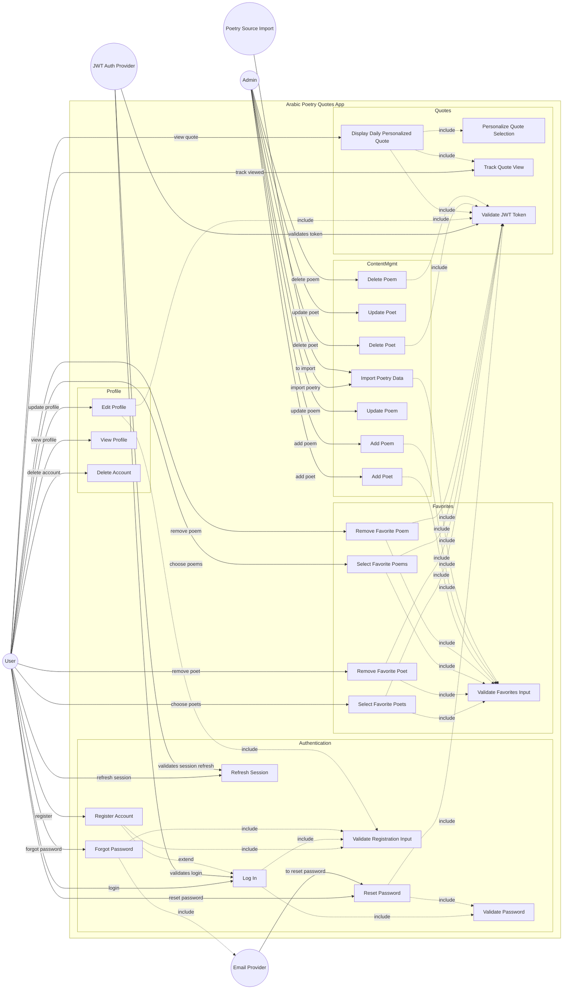
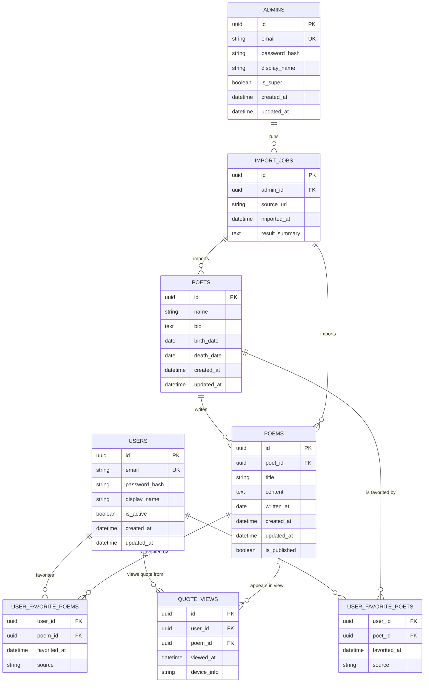
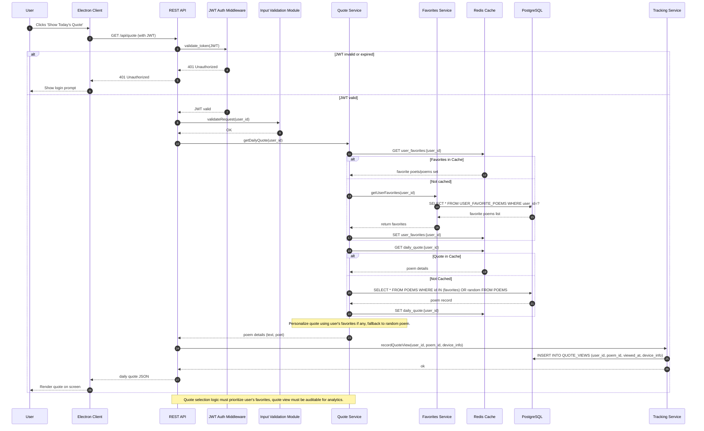

# Arabic Poetry Quotes Screen App

> Receive daily quotes from the rich realm of Arabic poetry.

A low-fidelity prototype of **Arabic Poetry Quotes Screen App**, generated by an agentic AI project manager from a stakeholder conversation in Slack.

## Screens

- [Home](index.html) — Navigate to register, login, or select favorite poets and poems.
- [User Registration](register.html) — Create an account to start personalizing your poetry experience.
- [User Login](login.html) — Access your account to receive personalized poetry quotes.
- [Select Favorite Poets](favorites.html) — Choose poets you admire to influence your daily quotes.
- [Select Favorite Poems](poems.html) — Select poems that resonate with you for quote selection.

## What this prototype fakes

- This prototype does not include backend functionality, data persistence, or user authentication.
- It simulates the user experience and navigation flow only.

## System design

### Comprehensive Use Case Diagram - Arabic Poetry Quotes App

This use case diagram details all interactions available to the core User actor within the Arabic Poetry Quotes App, framed against the application boundary. Features are organized into authentication, personalization, and daily quote activities. Additional supporting use cases include input validation, password management, session refresh, account profile editing, and the administration of underlying data (such as poet and poem curation). An admin actor is identified for poetry and poet data management. External dependencies (JWT Auth Provider as external SSO, third-party Poetry Source import, and optional Email Provider) are modeled as independent actors connected to the appropriate flows. Clear dependency relationships (via include and extend) are used to illustrate necessary reusable and conditional flows, totaling more than the minimum required nodes.

### Layered Solution Architecture and Key Data Flows

This architecture diagram shows the full layered breakdown of the Arabic Poetry Quotes App, separating client, API/backend, domain services, data storage, and external integrations. Each backend module handles a distinct domain: user management, favorites, quotes, profile, admin, validation, monitoring, and poetry import. Cross-cutting modules such as JWT authentication, logging/monitoring, and input validation are integrated at logical touchpoints. Data flow arrows are annotated by protocol (HTTPS, SQL, internal call, or async queue). Admin interfaces and third-party integrations, including an email provider (for resets) and poetry data import, are explicitly modeled, reflecting the extendability and maintainability of the solution.

```mermaid
flowchart TB
  subgraph client["Client Layer"]
    electron["Windows Desktop (Electron)"]
    adminUi["Admin Web UI"]
  end
  subgraph api["API / Backend Layer"]
    fastapi["REST API (FastAPI)"]
    jwt["JWT Auth Middleware"]
    logging["Logging & Monitoring"]
    valInput["Input Validation Module"]
  end
  subgraph services["Domain & Services"]
    userSvc["User Service"]
    favSvc["Favorites Service"]
    quoteSvc["Quote Service"]
    profSvc["Profile Service"]
    adminSvc["Admin/Content Service"]
    poetryImp["Poetry Import Service"]
    trackSvc["Tracking Service"]
  end
  subgraph data["Data Layer"]
    pg["PostgreSQL"]
    redis["Redis Cache"]
    objstore["Object Storage"]
  end
  subgraph ext["External Services"]
    authsvc["JWT Auth Provider"]
    emailSvc["Email Provider"]
    poetrySrc["Poetry Source API"]
  end

  electron -->|"HTTPS / JSON"| fastapi
  adminUi -->|"HTTPS / JSON"| fastapi
  fastapi -->|"Validate token"| jwt
  fastapi -->|"Validate input"| valInput
  fastapi -->|"log events"| logging
  fastapi -->|"call"| userSvc
  fastapi -->|"call"| favSvc
  fastapi -->|"call"| quoteSvc
  fastapi -->|"call"| profSvc
  fastapi -->|"call"| adminSvc
  fastapi -->|"call"| poetryImp
  fastapi -->|"call"| trackSvc
  fastapi -->|"queue jobs"| trackSvc
  fastapi -->|"ORM operations"| pg
  userSvc -->|"User queries"| pg
  userSvc -->|"cache profile"| redis
  profSvc -->|"Profile queries"| pg
  favSvc -->|"Favorites queries"| pg
  favSvc -->|"cache favorites"| redis
  quoteSvc -->|"Quote queries"| pg
  quoteSvc -->|"cache quote"| redis
  adminSvc -->|"Poet/Poem queries"| pg
  poetryImp -->|"fetch poetry"| poetrySrc
  poetryImp -->|"store files"| objstore
  poetryImp -->|"insert new poems"| pg
  adminSvc -->|"delete poet/poem"| pg
  jwt -->|"validate JWT"| authsvc
  userSvc -->|"password reset"| emailSvc
  logging -->|"log write"| objstore
  trackSvc -->|"insert quote views"| pg
```

### Normalized Persistent Data Model (ERD)

This ERD exhaustively models all SQL database tables needed for the Arabic Poetry Quotes App's complete feature set. It defines unique and foreign keys, user and admin attributes, join tables for each many-to-many relation (favorites and quote tracking), and includes a separate quote tracking table for analytics/audit. Rich metadata is stored for poems and poets, and admin accounts are managed separately for safety. The diagram accurately details data relationships such as a poet writing many poems, users favoriting multiple poems/poets, admins importing or editing content, and the requirement for full auditability via timestamps.

### Personalized Daily Quote End-to-End Flow

This detailed sequence diagram follows a user on the Windows client requesting their personalized daily Arabic poetry quote. The flow tracks each interaction, from API call with JWT to authentication, input validation, domain service routing, caching, and individualized quote selection based on current favorites. It includes alternate paths for unauthorized token handling and user state errors. Business logic notes specify the rules for quote personalization (using favorite authors/poems if present, otherwise a random selection) and for quote view tracking through the tracking service. The diagram also includes the caching optimization and audit of quote views, ensuring an accurate overview of operational and business rules.

## Running it

Every file is static. Open `index.html`, or serve the directory with any static file server.
